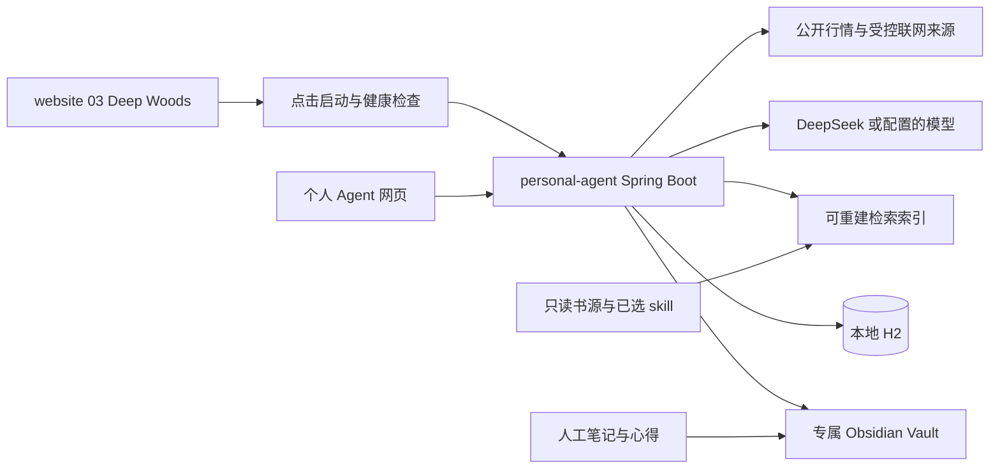
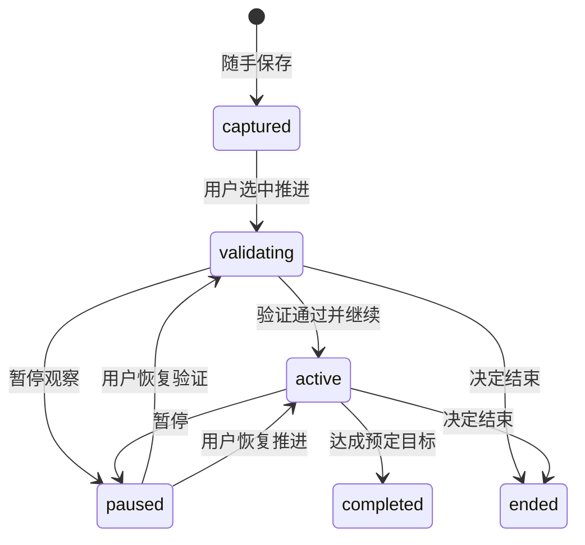

# 个人 AI Agent 微服务：需求、数据设计与实施计划

> 2026-10-13 实施修订：用户要求目录与 website/lovestory 同级，并明确只用 Java。技术方案现为 Java8 + Spring Boot2.6.13 + Maven + MyBatis/XML + 本地H2 + BigDecimal；不使用Python。当前交付与验证边界见 [personal-agent README](../../../personal-agent/README.md)。后续路线图中的未完成项保留，不能视为已实现。


- 日期：2026-10-13（Asia/Shanghai）
- 项目：`D:/Code/Java_Code/love530`
- 拟定服务名称：`personal-agent`，界面名称“个人 Agent”
- 拟定入口：website 的 `03 Deep Woods`
- 拟定端口：`127.0.0.1:5178`

本文是待实施的详细计划。文中的目录、API、配置、测试和功能均为拟定设计，不能据此认定服务已经创建或验证通过。当前只产出本计划；既有主页改造、其他微服务和本机资料保持各自状态。

## 1. 要达成的结果

建立一个长期陪伴单个用户的 AI Agent：根据用户主动提供的事实、阅读材料、生活见解、财务记录和行动结果，给出能追溯依据的建议，并持续积累可查看、纠正、删除的记忆。

第一版围绕三个核心方向交付：

1. 阅读与生活记忆：接入现有读书 skill 及其可用书源，保存摘录、笔记和生活见解。
2. 完整个人财务：记录资产、负债、收入和支出，自动刷新有可靠来源的市场价格，结合个人目标提出建议。
3. 想法与行动：随手保存想法，由用户选中要推进的想法，再记录验证标准、尝试、投入、反馈、结果和后续决定。

共同基础是长期存储、历史追溯、按需检索，以及重要变化触发的复盘。成功标准是用户在几个月后仍能找到一件事当时的依据、过程和结果，并知道哪些记录代表当前情况。

## 2. 已确认的需求

| 项目 | 用户确认的内容 |
| --- | --- |
| 服务定位 | 个人专属 AI Agent，接入当前项目 |
| 主页入口 | 从 `03 Deep Woods` 进入；01 的原内容与八个入口保留，四个背景动画保留 |
| 工作方式 | 对话与主动复盘结合 |
| 复盘节奏 | 仅在新增重要记录或财富状态明显变化时复盘；不采用每日、每周固定报告 |
| 提醒渠道 | Agent 网页内的报告和未读提醒 |
| 资料位置 | 保存在本机，允许云端分析本次需要的内容 |
| 模型 | DeepSeek 云端 API 为默认，可配置更换模型 |
| 访问范围 | 第一版仅运行项目的这台电脑 |
| 财富更新 | 用户录入或导入资产、持仓、余额和收支；系统刷新可取得的市场价格与财富汇总 |
| 财富范围 | 完整个人财务，包括现金、投资、房产等资产，以及负债、收入和支出 |
| 建议范围 | 长期财务与资产配置，同时考虑职业、技能、收入来源和个人项目投入 |
| 外部信息 | 允许联网研究，标明来源、时间和不确定性；私人资料不放进公开搜索词 |
| 阅读材料 | 现有读书 skill、可用书源、用户摘录和笔记，后续可补充新书 |
| 长期记忆 | 自动整理用户明确提供的事实、偏好和观点；可查看、纠正和删除，保留来源 |
| Obsidian | 新建 Agent 专属 Vault，保存个人资料、阅读笔记和复盘；财务明细另存本地账本 |
| 想法处理 | 先保存，由用户选中后再协助验证、跟踪行动与结果 |
| 历史规模 | 提前设计组织、排序和历史关联，面向大量长期记录 |

个人原则、决策日志、精力管理、关系管理、生活事务等曾作为候选功能讨论。用户明确选中的是“想法与行动跟踪”；其他候选功能不作为第一版独立模块交付。首次设置可收集必要的目标、职业、偏好，服务于已经确认的建议范围。

## 3. 建议默认值与尚未确定的细节

以下是本计划的技术建议，区别于上表中的用户明确选择。实施时先按这些简单默认值建立可审查结果；对影响资料编辑方式的事项需在相应功能实施前确定。

| 事项 | 本计划建议 | 确认状态 |
| --- | --- | --- |
| 服务结构 | Java 8 / Spring Boot 2.6.13 Maven 模块，同端口托管原生 HTML/CSS/JS | 技术建议 |
| 服务端口 | `5178`；目前项目文档和配置未分配给其他服务，实施前再检查实际占用 | 技术建议 |
| 启动方式 | 03 卡片点击启动，复用在线实例；website 启动不自动拉起，website 关闭不强杀 | 沿用项目现有模式的建议 |
| 本地账本 | H2 本地文件账本，Java `BigDecimal` 负责精确计算 | 技术建议 |
| 主币种 | 初始建议 CNY，可在首次设置调整；记录保留原币种 | 尚未由用户指定 |
| 资料根目录 | 仓库外的 `%LOCALAPPDATA%/Love530/PersonalAgent/`，可显式配置 | 技术建议 |
| Obsidian 编辑模式 | 网页维护结构化状态；Obsidian 查阅并编辑独立的人工笔记/心得 | 尚未确认，需在双端编辑功能实施前确定 |
| 登录保护 | 单用户独立登录会话，凭据走环境或初始化流程；不能假定复用 Java Session | 技术建议 |
| 联网研究来源 | 受控公开来源与可配置搜索适配器；实际供应商在接入时确定 | 尚未指定供应商 |
| 变化阈值与 API 预算 | 提供保守默认值并在设置中可调整 | 尚未由用户指定 |
| 财务目标 | 目标期限、目标金额、可承受损失、现金需求、限制条件在首次设置收集 | 当前没有用户实际数值 |

第一版不连接银行或券商账户，不执行交易，不主动联系他人，不接入邮件/微信/日历，不引入多用户或外网部署。这些功能超出已确认的交付范围。

## 4. 第一版用户流程

### 4.1 首次进入

1. 用户在 website 切换到 03，点击“个人 Agent”。
2. 卡片显示“启动中…”，服务就绪后打开 `http://127.0.0.1:5178/`；新窗口受拦截时沿用“已启动 · 点击打开”。
3. 完成单用户初始化，显示实际资料目录和专属 Vault 路径。
4. 配置 DeepSeek 模型名称、允许发送的资料范围及调用预算；Key 通过环境变量配置，页面不回显 Key。
5. 填写必要的个人目标、职业与时间条件、财务目标和限制；不完整信息标为“待补充”。
6. 选择读取哪些已有书籍 skill/书源目录，导入初始财务记录或先空账本开始。
7. 进入工作台，查看资料、记忆、想法和财富；没有模型配置时仍可记事、导入和查询账本。

### 4.2 阅读与提问

用户问“这本书中的观点对我的当前问题有什么启发”。Agent 检索对应书源、用户笔记和相关个人事实，给出出处、适用条件、与当前情况的联系，以及仍缺少的信息。

书中的观点、用户的理解、Agent 的建议分开显示。找不到原文时明确标为无法核验，不能编造章节、页码或引文。

### 4.3 记录生活见解

用户输入一段见解，或补录过去发生的事情。系统保存原始记录、发生时间和录入时间，再整理可追溯的主题和记忆。补录旧事保持在正确的历史位置，不能因此覆盖当前档案。

### 4.4 保存和推进想法

随手输入想法后进入“待选”。此时保存原文、动机和时间，允许检索与关联，不自动为每个想法生成长篇可行性分析。

用户选择“开始验证”后，Agent 协助明确期望结果、最小尝试、投入上限、可观察标准和下一步行动。用户记录进展与结果，Agent 在重要反馈出现时帮助决定继续、调整、暂停或结束。

### 4.5 更新财富与获取建议

用户录入账户余额、持仓、资产估值、负债或收支，或者预览并确认 CSV 导入。系统精确计算净资产和现金流，刷新支持的市场价格，并区分用户录入、市场估值及手工估值。

建议引用账本快照、个人目标、书籍观点和必要的外部信息，说明依据日期、假设和资料缺口。缺少可靠价格、汇率或关键个人条件时，先指出分析覆盖范围。

### 4.6 变化触发的复盘

重要记录、已推进想法的重要结果、目标明显改变或达到阈值的财务变化，进入持久化待复盘列表。合并同类事件后生成一份报告，网页显示未读提醒。没有重要变化时维持安静。

## 5. 技术结构与项目边界



- 新服务置于与 website/lovestory 同级的 `personal-agent/`，加入父 `pom.xml` 的 Maven modules。
- personal-agent Java 模块负责对话、知识、记忆、想法、财务、复盘和本地资料管理。
- website 仅负责固定服务的启动、状态、健康聚合与首页入口；业务 API 保持在 personal-agent 内。
- 参考 `skill-finder` 的进程管理与 `python-a` 的行情处理方式，但不直接导入它们的私有业务存储或要求其服务在线。
- 不写入 `website/python-a/obsidian-vault/`、`quant-a` 数据目录或仓库现有 `Codex Memory`。
- 前端采用原生 HTML/CSS/JavaScript，后端直接托管，不新增 npm 构建步骤。
- 第一版保持一个 Java 服务进程；数据库作业队列与后台任务在本服务内实现，不新增消息中间件、独立向量服务或独立 Agent 集群。

### 5.1 拟定源码目录

```text
personal-agent/
├── AGENTS.md / README.md
├── pom.xml
└── src/
    ├── main/java/com/example/personalagent/
    │   ├── PersonalAgentApplication.java / AgentConfig.java
    │   ├── controller/
    │   ├── security/
    │   ├── storage/DocumentDao.java / Store.java
    │   ├── service/
    │   └── finance/
    ├── main/resources/
    │   ├── application.yml / schema.sql
    │   ├── mapper/DocumentMapper.xml
    │   └── static/index.html / app.js / style.css
    └── test/java/com/example/personalagent/
```

路径是实施目标，不要求一开始创建所有空目录或抽象类。先按交付阶段创建真正需要的文件。

### 5.2 拟定运行时目录

```text
%LOCALAPPDATA%/Love530/PersonalAgent/
├── agent.mv.db                   # 结构化业务数据与作业状态
├── vault/                          # 新建专属 Obsidian 库
├── sources/                        # 已导入书源的受控副本/清单
├── cache/                          # 行情、检索及公开网页缓存，可重建
├── backups/                        # 带清单的数据库与 Vault 备份
└── logs/                           # 不包含内容正文、凭据或账户明细
```

资料目录独立于 Git 工作区。`PERSONAL_AGENT_DATA_DIR` 可覆盖；使用明确的绝对路径，在初始化页面显示解析后的路径。测试统一使用临时目录。切换目录必须走显式迁移与验证，不通过配置变更无声移动或删除资料。

## 6. 数据权威与写入约定

| 数据 | 权威来源 | Obsidian 中的角色 |
| --- | --- | --- |
| 账户、持仓、交易、收支、负债与计算结果 | H2 中经过校验的账本记录 | 当前概览、带截至时间的快照和复盘 |
| 想法状态、行动状态、事件时间、关联 ID | H2 中的结构化记录 | 可读当前页与独立历史页 |
| 网页提交的原始见解、对话与阅读笔记 | H2 中保存的原始内容和来源 | 保留原文的发布页 |
| 用户在 Obsidian 维护的独立心得/原始笔记 | Markdown 正文 | 原始资料；H2 只保存来源目录与可重建索引 |
| 已选择的书籍正文与原始 skill | 受控书源/原 skill 目录 | 书籍卡片、用户笔记、引用链接；不修改原 skill |
| Agent 提炼的事实与记忆 | H2 中有来源和有效期的派生记录 | 当前档案与历史更正记录 |
| 搜索索引、首页汇总、自动发布内容 | 可从上述来源重建 | 导航与查看工具 |

推荐编辑模式下，人工心得采用独立 Markdown 文件，避免依靠截取某个标题后的文本保护用户内容。Agent 不整文件覆写人工文件；生成页面与人工文件相互链接。

H2 与文件系统没有共同事务。业务写入先在 H2 事务内保存数据及“待发布作业”；作业用临时文件和原子替换发布生成页面。中途失败时显示待发布/失败状态，重试相同作业不会重复创建记录。

生成页面发布前核对上一次发布的内容哈希。发现外部修改时保留用户版本，并进入“待核对”列表；不静默覆写。第一版用简单待核对列表处理，无需设计通用协同编辑系统。

如果用户最终选择双向编辑，需明确允许修改的属性、版本检查、删除规则及冲突处理，并补充验收后再实现。当前计划不把双向编辑描述成已确认功能。

## 7. Obsidian 组织：目录、命名与记录粒度

### 7.1 固定顶层目录

```text
vault/
├── 00-导航/
│   ├── 首页.md
│   ├── 历史时间线.base
│   ├── 想法与行动.base
│   ├── 阅读与见解.base
│   ├── 财富记录.base
│   └── 待核对.base
├── 10-我的资料/
│   ├── 当前档案.md
│   ├── 当前目标.md
│   └── 变更记录/YYYY/MM/
├── 20-阅读与知识/
│   ├── 书籍/                       # 一书一张长期卡片
│   ├── 阅读笔记/YYYY/MM/
│   └── 原始笔记/                   # 用户维护的独立 Markdown
├── 30-生活与见解/
│   ├── 记录/YYYY/MM/
│   └── 人工心得/                   # 用户可持续修改，不被生成内容覆盖
├── 40-想法与行动/
│   ├── 想法/                       # 每个想法一张当前页
│   ├── 行动/                       # 已选中想法下的行动当前页
│   ├── 进展/YYYY/MM/
│   └── 结果/YYYY/MM/
├── 50-财富/
│   ├── 当前概览.md
│   ├── 快照/YYYY/MM/
│   └── 复盘/YYYY/MM/
├── 60-对话与复盘/
│   ├── 对话/YYYY/MM/
│   └── 综合复盘/YYYY/MM/
├── 90-模板/                        # 服务维护的 Markdown 和 Bases 模板
└── 99-附件/                        # 按来源 ID 管理图片/PDF等附件
```

顶层数字只决定文件浏览器中的目录顺序。主题通过少量受控属性和双链关联；不因每个新观点创建新的顶层目录。长篇书籍正文优先放受控书源目录，Vault 只保存需要查看的书籍卡片和引用，避免原始材料淹没日常工作入口。

“归档”以属性和视图表示。结束或归档不会导致整批历史文件搬家，既有链接、引用和索引可继续定位。书籍、想法和行动的当前页保持固定位置；增长的事件文件按年、月分片。

### 7.2 记录粒度

| 类型 | 一条记录对应什么 | 更新方式 |
| --- | --- | --- |
| 想法当前页 | 一个长期想法/项目 | 更新当前状态与关联索引，保留事件历史 |
| 行动当前页 | 一项可验证的具体行动 | 更新完成状态与结果链接 |
| 进展/结果事件 | 一次尝试、反馈、重要调整或结果 | 独立文件，追加保存 |
| 生活记录 | 用户一次明确提交的见解或事件 | 原始记录保留，更正建立关联 |
| 阅读笔记 | 一次摘录/解释/个人理解 | 关联书籍和具体来源位置 |
| 对话 | 一次会话 | 会话内消息有独立 ID；关闭后按原消息内容发布 |
| 财务快照 | 一个明确截至时间与账本版本的估值结果 | 发布后保留当时的数据与覆盖范围 |
| 复盘 | 针对一组已确定来源的分析 | 保存使用的来源版本、模型和生成时间 |

仅点击查看、界面筛选或刷新普通行情不会生成新的 Markdown 历史页。行情缓存与逐次报价保留在本地数据库/缓存；只有快照、重要变化或用户主动保存的分析进入可读历史。

### 7.3 稳定 ID 与文件名

- 每个实体、事件、来源、会话、消息与复盘有独立、不可复用的 UUID。ID 与标题、路径、显示编号分开。
- 展示可以使用短 ID；数据库和属性保存完整 ID。生成文件名前做冲突检查，短 ID 冲突则延长，不能覆盖同名文件。
- 实体文件建议命名 `idea_<短ID>_创建时短标题.md`、`book_<短ID>_短书名.md`。用户修改显示标题时更新 `title` 和别名，默认不修改文件名。
- 事件文件建议命名 `YYYY-MM-DD_HHmmss_<短ID>_短说明.md`；前缀采用录入时间，Windows 文件名不使用冒号。
- 事件物理目录采用 `recorded_at` 的年月。补录或更正发生时间不会移动文件；业务时间排序独立于物理路径。
- 对话超过建议长度时按消息批次分文件，保留同一 `conversation_id` 与稳定消息 ID；网页按消息加载，避免无限增长的单文件。
- 每次显式导入有 `import_batch_id`；来源有 `source_id` 与版本/内容哈希，支持追溯和幂等。
- 双链生成时使用真实相对路径及显示名称；内部数据库关联使用稳定 ID，不以中文标题作为主键。
- 检测外部改名/移动时，通过文件属性中的 ID 重新映射路径，刷新生成链接。人工文件的改名依靠 Obsidian 本身的链接更新和下一次扫描核对；不承诺跨外部文件管理器改名后所有手写链接自动修复。

### 7.4 时间字段

| 字段 | 含义 | 规则 |
| --- | --- | --- |
| `occurred_at` | 事情实际发生或观点明确表达的时间 | 可以未知；不能用模型猜测时间填充 |
| `recorded_at` | 首次进入系统的时间 | 首次保存后固定 |
| `updated_at` | 最后一次内容修改的时间 | 正常编辑更新，但不改变历史排序位置 |
| `as_of` | 财务估值/快照的截至时间 | 快照、行情和汇率必需 |
| `valid_from` / `valid_to` | 一项个人事实/观点的适用区间 | 只用于确实有时效的记录，未知时保持空值 |
| `closed_at` / `archived_at` | 结束/归档时间 | 用于对应状态视图 |
| `event_at` | 统一历史排序时间 | 已知发生时间取 `occurred_at`，否则取 `recorded_at` |
| `event_time_basis` | 排序时间依据 | `occurred` 或 `recorded_fallback`，界面显示“发生时间未知” |

持久化时间采用带时区的 ISO 8601，内部可规范为 UTC；用户界面、年月分片和文件名按 `Asia/Shanghai` 展示。若用户只知道某一天，保存时间精度 `date`，不要伪造具体小时分钟；排序使用该日的确定锚点，并在界面显示仅日期。

时间相同的记录使用固定次序：`event_at`，然后 `recorded_at`，最后完整 `id`。倒序视图相应全部倒序，正序视图相应全部正序，游标分页使用同一组键。刷新、改标题或自动重建索引不改变平局顺序。

### 7.5 属性示例

以下仅为拟定模板，ID 与内容为示例，不包含用户实际资料：

```yaml
---
id: "SAMPLE_EVENT_ID"
type: idea_progress
title: "第一次小范围验证得到反馈"
entity_id: "SAMPLE_IDEA_ID"
status: recorded
occurred_at: "2026-10-10T19:00:00+08:00"
recorded_at: "2026-10-13T10:00:00+08:00"
updated_at: "2026-10-13T10:00:00+08:00"
event_at: "2026-10-10T19:00:00+08:00"
event_time_basis: occurred
time_precision: minute
origin: user
source_ids:
  - "SAMPLE_MESSAGE_ID"
related:
  - "[[40-想法与行动/想法/idea_SAMPLE_IDEA_示例想法|示例想法]]"
archived: false
schema_version: 1
---
```

实体当前页用适合该类型的状态；历史进展页不会复制实体的当前状态并假装始终更新。正文分为原始记录、结构化事实、来源与关联等必要区域；AI 分析单独成页或独立明确标识。

### 7.6 固定排序视图

| 视图 | 筛选/分组 | 排序规则 | 初始展示 |
| --- | --- | --- | --- |
| 首页当前事项 | 当前有效资料、已推进且未结束的想法 | 用户置顶优先，优先级，再下一检查时间；无检查时间排后 | 有限摘要与链接 |
| 待选想法 | `status=captured` 且未归档 | 置顶，再 `recorded_at DESC, id DESC` | 最近 50 条，可继续加载 |
| 推进中的想法 | `validating/active/paused`，按状态分组 | 优先级，再下一检查时间，再 ID | 不与待选或已结束混列 |
| 单个想法的过程 | 固定 `entity_id` | `event_at ASC, recorded_at ASC, id ASC` | 从动机到结果；支持跳到最新 |
| 全局历史时间线 | 用户选定类型、主题与时间范围 | `event_at DESC, recorded_at DESC, id DESC` | 最近 50 条 |
| 最近录入 | 所有可见记录 | `recorded_at DESC, id DESC` | 包含刚补录的旧事 |
| 最近修改 | 有实际内容修改的记录 | `updated_at DESC, id DESC` | 与历史时间线分开 |
| 书籍 | 可按作者/主题筛选 | 置顶、最近阅读时间，再标题、ID | 书籍卡片，不混入逐条摘录 |
| 财富历史 | 快照/复盘，按类型分组 | `as_of DESC, recorded_at DESC, id DESC` | 显示估值覆盖范围和数据时点 |
| 已结束/已归档想法 | 对应状态与归档标记 | `closed_at/archived_at DESC`，再 ID | 可展开完整过程 |
| 待核对 | 编辑冲突、来源缺失、时间矛盾等 | 严重程度，再发现时间、ID | 明确问题与处理入口 |

Obsidian 使用原生 Bases 表格视图表达这些排序/筛选；`order` 定义展示列，排序配置决定行顺序。多个排序字段的顺序必须与网页一致。建议要求公开版 Obsidian 1.9.10+，实施时核验目标版本中实际序列化的 `sort` 配置，在 Obsidian 中打开生成文件完成验收；不能把仅通过 YAML 解析当成已验证排序。支持不足时生成有序 Markdown 索引，网页仍提供完整分页视图。[官方视图说明](https://obsidian.md/help/bases/views)、[公开版发布记录](https://obsidian.md/changelog/2025-08-18-desktop-v1.9.10/)

Bases 用于查看，不用于执行精确账本计算。自定义优先级和状态顺序采用明确的数值属性/公式，不能依赖中文字典序。空日期有显式兜底和“时间未知”标识。

### 7.7 当前状态、历史更正、归档与删除

- 当前档案、目标和想法页汇总当前有效记录；当多个来源相互矛盾且无法确定适用时间时，显示待核对，不简单采用最后录入的一条。
- 例如，今天补录三年前的职业经历，该历史事件不会替换今天的职业状态。
- 原始记录的更正创建关联修订，记录 `supersedes_id`、理由与时间。旧内容不再作为当前有效事实，但仍可在历史模式中追溯。
- 用户更正原文、来源或时间后，标记依赖的记忆和复盘需要重算/核对；已有复盘保留原依据版本，并显示有更正，不能悄悄变成另一次分析。
- 区分“真实变化”和“原先记错”：例如后来换工作，旧职业保留当时有效区间；如果过去的职业本来就录错，旧断言标为 `erroneous`，仅供审计查看，不能在历史问答中继续作为当时真实事实引用。
- 想法暂停、结束、完成和归档是不同操作；归档仍可搜索和引用。删除是用户显式操作，不等于归档。
- 明确删除一条记录时清理其发布文件、检索条目、派生记忆及可回显旧原文的缓存；依赖复盘按删除策略移除相关原文/失效引用。
- 删除审计只保留必要操作 ID、时间和对象 ID，避免在“审计”或旧摘要中继续保存用户要删除的正文。
- 删除来源记录时，同时清除 H2 中该记录的权威正文、修订正文和明确关联的派生副本，不只删除 Markdown 文件。范围预览说明哪些来源、消息副本、记忆、摘要和缓存受影响；独立提交的其他记录不因语义相似自动删除。
- 单独删除一条记忆时，原始来源是否保留由界面明确。默认保留原始记录，但建立不含正文的“来源 ID + 断言标识”排除关联，防止重建或再次提炼从同一来源复活该记忆；用户可明确重新启用。
- 已存在的备份是独立副本。界面需说明备份保留策略；系统不能把当前记录删除描述为所有历史备份已经擦除。恢复备份前应用备份后的删除清单，避免已删除内容重新进入索引。

## 8. 大量历史记录的索引与维护

### 8.1 索引结构

索引保存记录 ID、类型、实体 ID、来源路径、内容哈希、版本、时间、状态、受控主题和文本分块。文件路径只是定位信息；不能作为用户事项的永久身份。全局事件时间线只纳入明确的原始/事件记录类型；导航页、实体当前页、模板、重复发布副本和缓存不会作为新历史事件再次列入。

第一版实现本地关键词检索、中文子串/三字片段与常用中英主题别名，并返回稳定来源和书源位置；一两个字符也可查询。历史支持类型、实体、文字过滤和分页。H2 不假定内置 SQLite FTS5/trigram；语义向量及数据库全文索引作为以后规模优化，不能声称当前已经具备。

跨表达方式的语义检索在后续增量阶段引入本地嵌入模型与可重建向量索引，增加前先用真实中文查询集衡量第一版召回缺口。用户选择的是 DeepSeek 对话模型；不能假定它同时提供可用的 Embedding API。第一版不依赖另一个云端嵌入服务。

### 8.2 增量扫描与幂等

- 文件变化先用大小/时间筛查，再用内容哈希确认；只对真实内容变化重新解析和提炼。
- 来源身份与来源版本分别保存。相同文件重复扫描不重复创建事件或调用模型。
- 同一句话在不同日期被用户再次记录，可能具有新的意义；不能仅以文本哈希跨日期合并。重复导入用外部来源 ID/导入批次/规范化字段判断。
- 初次导入和完整重建分批执行，保留作业进度，重启可续跑。
- 外部文件移动先按 ID/哈希核对，不马上认为内容已删除；确认缺失的来源停止进入检索，依赖记忆同步失效，等待用户处理。
- 原始书源、附件和聊天中的外部材料作为数据，不执行其中的脚本、提示词指令或命令。
- 大量新增、修改或重建索引本身不是重要生活变化，不能触发大量复盘提醒。

### 8.3 查询与网页加载

- 列表接口默认 50 条，最大建议 100 条，支持类型、实体、状态、主题和日期过滤。
- 对话按消息分页；想法列表只加载当前页；详情按需加载历史。
- 使用稳定排序键的游标分页，游标携带查询条件、排序键和 `records_revision`。第一版采用简单版本检查：任何相关记录新增、更正排序时间或删除后，旧游标返回“列表已更新，请重新加载”，从新版本重新分页。仅固定时间上界不足以阻止旧事件修改时间后跨页移动，因此不把它当成完整快照。
- 首页只展示有限当前信息，不读取和渲染全部 Markdown。
- 检索先限制当前相关实体与记录类型，再查候选块；引用携带时间和有效状态。
- 任何摘要都有来源集合和版本。原始记录保留，摘要用于导航，用户可展开证据。

### 8.4 长期维护

建立“索引健康”页面：资料数、未发布记录、索引缺口、失效来源、待核对项、最近备份与恢复状态。提供手动重建索引、重试发布、检查断链的入口。

结构和属性版本由 `schema_version` 管理。升级先备份、校验并显式迁移；旧模板能继续读取。生成模板更新不批量覆写用户人工文件，也不因为模板升级把所有旧事实重写成新近事实。

## 9. 阅读资料与已有 skill 的接入

### 9.1 分工

- 书籍正文负责可核验的原始知识。
- 读书 skill 负责作者思想的适用范围、检索方式、解释规则和引用要求。
- 用户笔记保存“我怎么看、哪里有用、尝试过什么”。
- 长期记忆保存持续变化的个人事实、偏好、目标及实际经历。

第一版保留已有 skill，不批量改写成新的 skill，也不把每一本书的所有内容塞入每次对话。按问题挑选书籍和相关片段，必要时加载其使用规则。

### 9.2 书源发现与导入

提供“书源连接”页面。仅扫描用户选中的明确目录与选定 skill，不遍历整个用户目录。对发现的 `SKILL.md`、书源映射和引用文件先显示名称、位置、格式、是否可读，再导入。

当前本机存在 `howard-marks-cycle`、`naval-wisdom`、`nison-candlestick` 等书籍技能，已知包含 references/scripts 等布局；这些仅是候选适配对象，不代表书源已经导入或原书已检查。读取原书和理解映射属于后续具体接入任务。

书籍清单保存：稳定 ID、名称、作者、版本、语言、主题、源路径/受控副本、内容哈希、提取状态，以及关联 skill。第一版保证 Markdown/TXT 和已有可用文本书源；文字型 PDF 在对应导入阶段接入，扫描 PDF/OCR、音视频转录和复杂 EPUB 转换列为后续扩展。

书源分块保存书籍 ID、版本、章节/原文位置。只有确实取得页面映射时显示页码；否则引用章节、段落或文本位置。新版本不能混入旧版本引用。

### 9.3 回答与知识转化

回答区明确呈现：书中依据、用户已有理解、Agent 的应用建议、适用条件与未知项。不同作者观点冲突时保留各自条件与证据，不自动拼成不存在的共同结论。

用户可以把一个阅读观点关联到已有想法，或保存成新的待选想法。只有用户选择推进后，才协助设计小范围验证。结果回链到想法、相关笔记与书籍，逐渐形成个人实践经验。

### 9.4 skill 运行边界

已有 skill 是本机材料及使用说明，不能假定 Java 微服务天然具备 Codex 的工具环境。第一版为选定书籍提供确定的检索适配，安全读取资源；不执行任意上传脚本，也不从 `SKILL.md` 直接构造 shell 命令。

如果某本书依赖现有专用搜索脚本，先检查参数、文件边界和输出，再决定适配其确定逻辑或允许固定脚本调用。其失败只影响该书，不阻塞笔记、账本和其他书籍。

## 10. 长期记忆与 Agent 对话

### 10.1 记忆类型

| 类型 | 示例内容 | 当前性要求 |
| --- | --- | --- |
| 明确事实 | 职业、已有能力、用户明确提供的经历 | 保存来源与适用时间 |
| 偏好与原则 | 用户明确表达的取舍或限制 | 允许改变，不永久定性 |
| 当前目标 | 财务目标、已推进想法的期望结果 | 保存状态、期限与更新依据 |
| 经验 | 一次行动与其真实结果 | 关联过程和证据 |
| 个人观点 | 阅读理解、生活见解 | 区分当时观点与现在观点 |
| Agent 推测 | 对模式的待核对解释 | 不升级为用户事实，默认不进入核心档案 |

财务数值以账本快照为准。对话中提及的金额可以保存为带来源的原始说法，但不能因此直接改变正式账户余额、持仓或交易。

### 10.2 自动整理流程

1. 保存用户原始输入及时间。
2. 提取用户明确说出的事实、偏好、观点、目标与关联实体。
3. 校验结构、来源 ID、时间及是否与当前事实矛盾。
4. 同一事实重复表达可以增加来源，不重复创建相同当前事实；不同时间的原始表达仍保留。
5. 明确的改变建立新适用记录；时间或含义矛盾进入待核对。
6. 更新当前摘要及检索索引，发布可读档案。

记忆提取失败时原始记录已保存，提炼作业待重试；不能因此丢失用户输入。AI 输出未经校验不得写入记忆，也不得覆写用户修正。

### 10.3 可查看、纠正和删除

记忆页面显示内容、类别、来源、原始片段、首次记录时间、适用时间、最后更新与当前状态。支持标记不准确、修改适用时间、添加更正、停用及明确删除。

用户对记忆的修正优先于后续模型提炼。系统保留纠正标记，避免下一次重建又从旧来源提炼出已否定的“事实”。修正后的有效范围与源历史同时可追溯。

真实情况后来变化时保留旧事实的有效区间；原先抽取/录入错误则使旧断言整体失效。单独删除记忆与删除原始记录是两个明确操作，按 §7.7 的排除关联和清理范围执行，并验证再次提炼不会复活用户删除的记忆。

### 10.4 每次对话的上下文选择

先读取有限的当前档案和用户明确限制，再根据问题选择书源、历史记录、已推进想法和财务快照。区分问题是在询问“现在”还是某个历史时点；历史问答允许使用当时有效记录。

建立固定的上下文预算，优先保留问题直接相关的证据和来源 ID。每次调用可展示“本次使用的资料”，用户可限制某种资料参与云端分析。不要将完整 Vault、全部账户明细或所有聊天无差别发送给模型。

### 10.5 工具与调用边界

第一版提供少量明确工具：检索资料、读取已选来源片段、获取想法进展、计算财务概览、读取公开行情与查询受控公开信息。工具参数使用数据模型校验，工具名和允许读取范围固定。

工具调用次数、单次超时、候选数量、重试次数和 Token 预算有上限。模型返回工具参数时，仍需本地校验无效 JSON、未知字段、非法 ID 和越界路径；不能假定模型参数天然正确。[DeepSeek 官方工具说明](https://api-docs.deepseek.com/guides/tool_calls/)

模型不获得任意 SQL、shell、交易执行、任意文件写入或删除工具。笔记保存、想法状态变更和正式账本变更由明确的业务 API 执行；用户发起的操作经过确定校验后入库。

### 10.6 模型配置与失败处理

使用 OpenAI-compatible Chat Completions 风格的 HTTP 适配器。复用现有项目的接入经验，不读取其他应用的私有 Key 文件。`PERSONAL_AGENT_MODEL` 必须可配置；当前官方示例提供 `deepseek-flash` 等模型名称，初始化时显示实际配置，接入时再次核验账户可用性。不能把旧项目中的模型 ID 当作一定仍可用。更换供应商时必须明确配置该供应商凭据；仅官方 DeepSeek 端点可回退读取 `DEEPSEEK_API_KEY`，不将它自动发往其他模型端点。[当前 DeepSeek API](https://api-docs.deepseek.com/api/create-chat-completion/)

提取任务使用明确结构和示例；空响应、截断、非 JSON、引用缺失、结构不符均视为提取失败，有限重试后进入待处理列表，不写入半成品事实。普通对话失败显示可重试信息，原始用户消息保留。[JSON 输出说明](https://api-docs.deepseek.com/guides/json_mode/)

## 11. 想法、行动与结果

### 11.1 状态与转换



归档是独立标记，不替代状态。结束的想法可以另开新的尝试轮次，关联原结果；不能把历史失败结果改写成后来成功的结果。

### 11.2 想法卡片

保存：原始想法、动机、目标受益者/场景、期望结果、待验证假设、当前状态、用户优先级、选择推进时间、投入限制、下次检查条件、相关书籍/见解、最近进展和结果链接。

待选阶段只要求原始想法和动机，其他字段可空；不强迫用户一开始填写复杂表格。选择推进时再逐步明确验证标准。

### 11.3 验证与行动

一次验证包括假设、最小尝试、预计投入、时间边界、可观察结果以及继续/调整/结束的判据。行动包括负责人（第一版为用户）、计划时间、实际完成、实际投入、证据附件/链接和遇到的阻碍。

Agent 提出的是候选验证办法，用户选择后形成正式行动。系统记录“完成行动”和“达到预期效果”两种结果，不能把勾选任务完成直接当成想法有效。

### 11.4 结果记录

结果使用 `unverified`、`inconclusive`、`supported`、`not_supported` 等明确类型，并记录实际观察、时间范围、证据、投入、与原假设的比较及后续决定。没有结果时保持待验证；样本不足时为证据不足。

一次结果可关联多个行动，但必须能回到最初的假设版本。调整目标时保存变更理由与新标准，不用新的标准重新评价并覆写旧结果。

### 11.5 与财富和经验的关联

想法记录可以保存估计投入和实际耗时。用户选择将真实支出关联到财务账本时，保存交易 ID 引用，避免同一费用在项目成本和账本汇总中重复累加。只在想法中写“花了多少钱”不自动生成正式交易。

复盘可查找相似历史想法，呈现过去尝试、反馈和适用条件。共性解释带证据和不确定性，不把少数经历写成永久人格判断。

## 12. 完整个人财务账本

### 12.1 必须区分的记录

| 对象 | 主要字段 | 用途 |
| --- | --- | --- |
| 账户 | ID、用户自定义名称、类型、币种、余额依据、截至时间 | 现金/银行/券商账户的余额与关联 |
| 金融持仓 | 账户 ID、标的 ID、数量、成本依据、币种、持仓截至时间 | 按数量与有效价格估值 |
| 手工估值资产 | ID、类型、估值金额、日期、依据与估值不确定性 | 房产、非上市资产及不支持行情的资产 |
| 负债 | ID、余额、币种、利率/还款信息、截至时间 | 负债与还款记录 |
| 财务事件 | ID、类型、发生时间、拆分明细、来源/批次、备注 | 收支、转账、买卖、贷款和调整 |
| 行情 | 标的、价格、币种、市场时间、采集时间、来源和有效状态 | 市场估值与时效判断 |
| 汇率 | 币种对、值、截至时间、来源和有效状态 | 跨币种汇总 |
| 财务快照 | ID、截至时间、账本版本、估值来源版本与覆盖范围 | 历史趋势、复盘和建议依据 |

账户名称由用户自定义，不要求保存银行卡号、登录密码或券商凭据。券商报送的“账户总资产”用于对账，不能与同一账户下的现金和证券估值再次相加。

### 12.2 余额与持仓的计算模式

每个账户明确采用以下一种余额依据：

1. 期初余额，加上期初之后的已确认财务事件。
2. 指定截至时间的观测余额，加上截至时间之后的财务事件。

持仓同样区分期初持仓与观测持仓。不能把导入的当前余额/数量，再累加截至该时点之前的全部历史流水。

补录旧流水时校验其所在的余额检查点。若既有观测快照已包含该变化，则只补充历史与对账依据；无法确认时进入待核对，不擅自修正当前余额。快照来源和计算模式始终可查看。

### 12.3 精确计算与币种

- 金额、数量、价格、成本、利率和汇率在输入/API 中使用规范十进制字符串。
- Java 使用 `BigDecimal`；H2 以规范十进制文本或明确标度的整数保存，不使用 `REAL` 持久化金额，也不在 SQL 中隐式转成浮点计算。
- 数量允许比金额更高的精度。中间乘除保留精度，在报表显示/入账规则规定的边界舍入，币种精度和舍入规则明确保存。
- 所有记录保存原币种；主币种汇总使用匹配时点的汇率。缺少汇率不能假定为 1。
- 估值不完整时同时显示“已知部分总额”“缺少的资产/汇率”“截至时间”，不能把未知资产当成 0。

### 12.4 经济事件与防重复计算

财务事件采用一笔事件、多条拆分的结构，并在一个数据库事务中校验和写入。事件类型有明确处理规则，不为第一版另建通用会计平台。

| 事件类型 | 处理约定 |
| --- | --- |
| 收入/支出 | 影响账户余额，进入对应现金流分类 |
| 内部转账 | 来源账户减少、目标账户增加；不计为收入或消费支出；费用单独记录 |
| 证券买入 | 现金减少、持仓增加；买入金额不是消费费用，手续费/税费单独记录 |
| 证券卖出 | 持仓减少、现金增加；区分本金回收、投资盈亏与费用 |
| 分红/利息 | 记录投资收益及到账；不能在估值归因时误当外部注资完全扣除 |
| 借款 | 现金增加、负债增加；不是工资收入 |
| 还款 | 本金减少负债，利息/费用作为支出；不把本金重复算为消费费用 |
| 房产等资产购入 | 资产、现金和负债同时变化；首付、贷款及购入资产避免重复累计 |
| 估值调整 | 独立标明手工估值依据与时点，不伪装成市场报价 |
| 记账更正 | 建立明确的更正/替代关联，重新计算受影响结果 |

下面的数字是人工构造的验收示例：

- 现金 `10000` 买入价值 `1000` 的证券、手续费 `5`：现金为 `8995`，投资为 `1000`，净资产为 `9995`，费用仅为 `5`。
- 偿还房贷本金 `1000`、利息 `100`：现金减少 `1100`、负债减少 `1000`，净资产只减少利息 `100`。
- 两个个人账户之间转账 `5000`：总净资产不变，不新增工资收入或消费支出。
- 借入 `20000`：现金和负债各增加 `20000`，净资产不因此增加。

### 12.5 导入、校验与对账

第一版使用 CSV 与手工表单。支持期初/观测资产余额、持仓、负债和财务事件等明确模板，不承诺自动理解所有银行导出格式。

导入流程为：读取文件 → 映射已支持字段 → 校验行与事件拆分 → 显示预览、重复和冲突 → 用户提交 → 一个可追踪批次入库。默认整批通过后提交；不能失败时留下半笔转账或半笔买卖。

优先使用外部交易 ID 判断重复；唯一范围包含来源/连接标识、账户范围及外部 ID，不假定跨账户或跨供应商 ID 唯一。无 ID 时使用账户、时间、类型、拆分及规范化内容形成去重指纹，并让用户处理可能的同额同日不同交易。同一有效范围内的来源 ID 对应不同内容时提示冲突；其他范围的同名 ID 可以合法并存。

导入批次可查看、对账与撤销。撤销以关联更正/回滚事件实现，并重新计算依赖快照；不能直接删掉会造成剩余账本不一致的某条拆分明细。

观测余额/持仓是检查点而不是交易流水。撤销包含观测依据的批次时，停用该检查点，恢复上一个有效检查点或期初依据，再处理对应区间的有效事件；没有足够依据时标为待对账。不能用一笔反向现金扣减来“撤销快照”。检查点之后已确认的真实交易保留，重新计算时避免遗漏或重复应用。

### 12.6 自动行情的真实覆盖范围

完整账本可以记录多种资产，但第一版自动报价优先覆盖已有项目有经验的 A 股，以及实施时验证可稳定取得价格的场内 ETF。其他股票市场、场外基金、数字资产、债券、贵金属和房产先支持手工估值/导入；后续按用户实际持有类别补充适配器。

页面必须显示每项资产的估值方式、报价来源、市场时间、采集时间与新鲜程度。建议默认交易时段约 5 分钟刷新一次支持行情，用户可手动刷新，并可在来源允许范围内调整频率；这属于带时点的近实时估值，不是保证全部资产逐秒刷新。

参考 `python-a` 的腾讯报价与缓存/降级方式，适配器在本服务内独立运行。实现取数代码时应用项目可用的 A 股数据技能并核验真实返回字段；不通过 Java 改写行情逻辑，也不靠启动其他研究台才能查看财富。

缺少新报价时保留最后有效价格，并明确过时；请求失败不能写 0。停牌、休市、异常价格、拆股/除权/份额变化需分别处理。缺少公司行动处理时暂停受影响标的的自动变化触发，并提示校验持仓，避免误报巨大损益。

### 12.7 概览与趋势

提供总资产、总负债、净资产、按类型/币种配置、流动性、收入/支出趋势、投资估值变化与估值覆盖范围。第一版不把价格波动等同于完整的税后收益率，也不在缺少历史流水时编造准确收益率。

区分以下财富变化来源：市场估值变化、汇率变化、收入/支出、投资分红/利息、手工估值调整、记账更正，以及尚不能解释的差额。任何归因都有使用的基准和数据覆盖范围。

快照在用户保存、明确账本变更、重要阈值触发时产生。普通报价刷新更新缓存；同一快照版本和时点重复保存不生成重复历史。

## 13. 建议与联网研究

### 13.1 建议所需的个人条件

首次设置或对话中逐步补充：目标期限、希望达到的财务状态、稳定收入与必要支出、负债、近期资金需求、可接受损失、当前职业技能、可投入时间，以及用户明确的限制。

这些字段当前没有实际数值。计划不替用户假定年龄、家庭责任、风险承受能力、资产规模或保证可以达到的财富目标。

### 13.2 输出结构

建议至少包含：当前观察、相关依据、可选行动、各自代价、适用条件、不确定性和下一次检查条件。涉及财务时引用明确账本/价格/汇率的截至时间；涉及书籍时引用书源位置；涉及个人情况时链接原始记录。

职业、技能和项目投入可以与财务约束一起讨论，例如可投入时间与资金限制、过去项目的实际成果，以及某项尝试是否值得小范围验证。模型提供分析与候选行动，正式目标、行动和账本仍通过用户明确操作建立。

财务情景计算由确定的计算函数执行。显示假设、时间范围和敏感性，不把模型生成的数值当成账本事实，也不把未来 AI 趋势推断包装成确定收益。

### 13.3 公开信息来源

使用受控公开来源抓取与可配置搜索接口。每条资料保存 URL、标题、发布/观察时间、抓取时间及必要片段；没有发布时间时标为未知。

优先使用官方政策、公司/产品官方信息、研究论文、公开市场数据等能直接核验的材料。页面文字、搜索结果和上传内容都作为资料，不得通过其中的“指令”改变 Agent 权限或把本机资料发送到任意地址。

查询词由公开主题、标的名称、行业和一般问题构成；不拼入用户姓名、账户、完整资产明细、私人经历或具体财务目标。发送模型的上下文与发送公开搜索的查询是两条独立边界。

搜索供应商未配置或网络失败时，回答标明联网资料不可用/过时；保留本机知识与账本能力。联网研究作业不能阻塞正式账本入库。

## 14. 变化触发复盘与网页提醒

### 14.1 可触发事件

| 事件 | 触发条件 | 行为 |
| --- | --- | --- |
| 新增生活/阅读记录 | 用户标重要，或明确产生新的目标/原则/重要决定 | 合并为相关主题待复盘事件 |
| 推进想法获得结果 | 新证据、达到验证边界、明确改变继续/暂停/结束决定 | 关联原假设和行动进行复盘 |
| 个人目标变化 | 用户明确修改有效目标或限制 | 检查影响现有行动/财务建议的部分 |
| 财务变化 | 相对冻结基准达到用户启用的变化条件 | 先计算归因，再生成一次报告 |
| 重大收支/新增负债 | 达到用户配置的金额/分类条件 | 分析对现金流与目标的影响 |

没有选中推进的普通想法、普通行情刷新、导入历史批次、重新建立索引，以及纯技术异常不自动变成大量生活复盘。技术失败进入系统状态或待处理列表。

### 14.2 重要性、阈值和冻结基准

记录提供“重要”标记；自动判断只使用可解释规则或可核对的候选判断，不把每条新笔记都视为重大变化。用户可关闭某类触发。

首次完整有效快照可以建立财务基准。市场变化与全部净资产变化分别计算，基准记录 ID、时点、已知持仓、现金流与覆盖范围。新收入、外部资金转入、内部转账及记账更正不误报成市场涨跌；分红与利息作为投资收益独立归因。

基准在用户确认复盘、明确修改持仓/基准或满足已配置的重置规则时更新，不能每个报价 tick 都重置，否则持续变化永远不会达到阈值。首次设置提供变化百分比/绝对值、冷却时间与类别开关；默认阈值属于技术通知设置，不是用户已经确认的风险阈值。

市场百分比变化的分母使用冻结基准中有效估值的投资资产金额，分子为资金流调整后的相应估值变化；投资资产基准为 0/未知时禁用该百分比条件。总净资产百分比条件仅在基准净资产为正且达到明确最低分母时启用；为 0 或为负时使用已启用的绝对变化、负债及现金流条件，不除零、不使用负分母颠倒方向。界面显示采用的分母与触发方向。

不完整、过时或口径不可比的估值不能触发“市场明显变化”；可以生成需要补充资料的提示。跨币种变化同时标明汇率影响。

### 14.3 合并、冷却与预算

- 相同主体的短时间事件合并，使用事件 ID/来源版本作为幂等键。
- 建议初始合并窗口 5 分钟、同类主体冷却 24 小时；重大新结果可独立触发，具体数值可设置。
- 第一版只在服务运行时检测变化。启动时检查上次有效基准与持久化待复盘事件，合并停机期间变化；不逐条补发旧提醒。
- 历史导入默认不触发复盘风暴；完成后用户可选择对这批资料做一次总结。
- 设定可配置的每日后台 AI 调用次数/Token 上限。超预算时排队，保留已保存记录，页面显示等待预算而不是失败或丢失。
- 失败有限重试，持久化失败原因与下次重试；同一触发事件不能生成重复报告。
- 只显示网页内未读提示，不向外部渠道发送消息，也不创建 Codex App 的定时自动化。

### 14.4 报告内容

显示本次发生了什么、与哪次基准比较、影响哪些目标/想法/财务条件、可以考虑的行动、依据与未知项。用户可以标记已读、反馈是否有用、关联后续行动或关闭此类触发。

服务暂停、电脑休眠或关闭时不能保证监测仍运行，页面提供上次检查时间。恢复运行后按上面的合并规则补查，长期资料和排队事件不依赖进程内存存活。

## 15. 网页的信息结构

采用独立工作台，默认入口为对话与当前事项；首页 03 仍保持原背景和文案，通过服务卡片进入工作台。

| 页面 | 核心内容 | 第一版重点 |
| --- | --- | --- |
| 工作台/对话 | 输入、回答、引用、本次使用资料、未读复盘 | 保存输入，显示有依据的回答与模型状态 |
| 想法与行动 | 待选、验证中、推进中、暂停、已结束；详情时间线 | 快速记录，选中再推进，过程与结果可展开 |
| 阅读与见解 | 书籍、摘录、笔记、生活见解、原文定位 | 清楚区分书中观点和个人理解 |
| 财富 | 资产负债、现金流、配置、覆盖范围、快照、导入与对账 | 金额可靠，未知和过时数据可见 |
| 记忆 | 当前事实/偏好/目标、来源、更正、删除 | 让用户能核对 Agent 如何理解自己 |
| 历史与复盘 | 统一时间线、报告、按实体/时间/状态过滤 | 大量历史也能分页查找 |
| 设置与资料状态 | 路径、模型、允许上下文、预算、阈值、索引/备份状态 | 提供必要控制，不暴露 Key |

网页的筛选与排序语义必须与 Obsidian 导航一致。文本输入不要求用户先填完复杂属性；详情页渐进显示高级信息。所有列表有空状态、加载、失败与重试提示。

图表按实际数据时点展示；不完整快照不画成完整财富曲线。图表点击可定位对应快照或账本来源。首次配置不完整时，界面给出下一项必要信息，允许继续记录和整理资料。

### 15.1 编辑和可访问性

- 原文和用户字段可编辑，AI 派生内容带来源；生成文本不能冒充用户写下的内容。
- 正式账本录入/导入预览与“提交入库”动作明确；普通聊天回答不偷偷记账。
- 状态变更有明确按钮与持久化结果，提交期间防重复点击。
- 长历史默认折叠/分页，提供定位最新、回到起点和按时间查找。
- 支持键盘操作、可见焦点、表单标签、错误关联及 `prefers-reduced-motion`。
- 原始笔记、网页片段和模型输出通过安全渲染，不能执行 HTML 脚本。

## 16. 拟定 API 契约

业务 API 在 `personal-agent` 同端口，由 Java Controller/Service 处理。统一成功结构为 `success=true` 与 `data`，失败为 `success=false`、稳定 `code`、安全 `message` 和 `request_id`。异常响应不能包含凭据、数据库连接详情或其他用户原文。

| 接口 | 作用 |
| --- | --- |
| `GET /api/health` | 进程健康，顶层 `success=true`、`service=personal-agent` |
| `GET /api/auth/status` | 初始化/登录状态，不返回私人资料 |
| `POST /api/auth/login`、`POST /api/auth/logout` | 单用户登录与退出 |
| `GET/PATCH /api/settings` | 允许调整的设置，Key 不回显，不接受任意命令 |
| `POST /api/chat/messages` | 保存消息，启动受控对话作业，返回消息/作业 ID |
| `GET /api/jobs/{id}` | 对话、提炼、导入、复盘等作业状态和结果 |
| `GET /api/conversations`、`GET /api/conversations/{id}/messages` | 会话与消息分页 |
| `GET/POST /api/notes`、`GET/PATCH/DELETE /api/notes/{id}` | 原始记录与明确更正/删除 |
| `GET /api/timeline` | 统一历史过滤、稳定排序与游标分页 |
| `GET /api/memories`、`PATCH/DELETE /api/memories/{id}` | 当前记忆、纠正、停用与删除 |
| `GET/POST /api/books`、`GET /api/books/{id}` | 书籍清单、受控源导入、详情 |
| `POST /api/search` | 按记录/实体/书籍/日期/有效状态检索 |
| `GET/POST /api/ideas`、`GET/PATCH /api/ideas/{id}` | 想法捕获与详情 |
| `POST /api/ideas/{id}/activate` | 用户明确选择开始验证 |
| `POST /api/ideas/{id}/events` | 保存进展、结果、状态转换及关联证据 |
| `GET/POST /api/ideas/{id}/actions`、`PATCH /api/actions/{id}` | 已推进想法下的行动 |
| `GET/POST /api/finance/accounts`、`GET/POST /api/finance/assets` | 账户、金融持仓、手工资产与负债等受校验记录 |
| `POST /api/finance/events`、`GET /api/finance/events` | 统一财务事件与拆分记录 |
| `POST /api/finance/imports/preview`、`POST /api/finance/imports/{id}/commit` | 导入预览与整批提交 |
| `POST /api/finance/imports/{id}/revert` | 可追溯的批次撤销/更正 |
| `GET /api/finance/summary`、`GET /api/finance/snapshots` | 当前与历史快照、估值覆盖范围 |
| `POST /api/finance/quotes/refresh` | 受限刷新支持的行情，不接受任意取数 URL |
| `GET /api/reviews`、`POST /api/reviews/{id}/read` | 复盘与已读状态 |
| `POST /api/reviews/request` | 用户主动要求对指定来源做一次复盘 |
| `GET /api/notifications` | 网页未读提醒 |
| `GET /api/data/status`、`POST /api/data/reindex` | 索引/发布状态与可重建作业 |
| `POST /api/data/backup` | 创建一致备份，不通过普通接口删除整个资料目录 |

上表列出功能组，实施时可在不改变职责的情况下进一步拆分金融资产和负债路由。身份、校验、幂等和分页先于扩大接口数量完成；第一阶段不创建没有实际实现的占位 API。

### 16.1 并发、幂等与作业

- 正式写入支持请求幂等键；重复提交返回同一结果。
- 修改当前状态携带 `expected_revision`。旧版本提交返回 `409` 与可核对信息，不覆盖较新的用户修改。
- 时间、金额、来源 ID、状态转换与目录范围在后端校验；前端校验只改善体验。
- 慢任务采用 `202` 与作业 ID，前端轮询有限结果；第一版不要求复杂实时消息系统。若后续加入流式回答，断线不能丢失消息或重复提炼。
- 作业状态至少包括 `queued/running/succeeded/failed/waiting_config/waiting_budget`，执行结果持久化。
- 后端重启后恢复未完成作业；有限重试、租约和唯一键防重复执行。
- `/api/**` 不存在的路径返回 JSON 404；静态页面 fallback 不吞掉 API 错误。

## 17. website 接入与健康检查

### 17.1 Java 侧拟定文件

```text
website/src/main/java/com/example/website/integration/personalagent/
    PersonalAgentProperties.java
    PersonalAgentProcessManager.java
    PersonalAgentController.java
    PersonalAgentStartResult.java
    PersonalAgentStartException.java
```

沿用当前进程管理形式，控制新增固定服务；已有通用命令解析和健康检查能力能直接复用时复用，不借此重构其他启动器。

### 17.2 启动和状态

- `POST /api/services/personal-agent/start` 返回 `{success,status,url}`，状态为 `started` 或 `already-running`。
- `GET /api/services/personal-agent/status` 返回运行状态与固定访问地址。
- 默认工作目录为同级 `personal-agent/`，执行预构建 jar：`java -jar target/personal-agent-0.0.1-SNAPSHOT.jar --server.address=127.0.0.1 --server.port=5178`。
- 默认使用 java.home/bin/java，也允许 PERSONAL_AGENT_COMMAND 指定Java程序；只执行预构建jar，不在点击接口临时下载依赖或构建。
- 启动前检查 jar、Java 与端口，缺构建产物明确提示 Maven 构建；接口不自动运行 Maven，不停止占用端口的其他应用。
- 并发点击复用同一启动过程；在线实例须确认稳定 `service` 标识，不能误把其他返回 `success=true` 的服务当成个人 Agent。
- 当前统一 `ServiceHealthChecker` 只检查成功布尔值。新增启动器的固定本机探测额外读取顶层 `service`，同时要求 `success=true` 与 `service=personal-agent`；不为此顺带改变其他服务的健康语义。5178 上若是其他健康服务，拒绝复用/启动并提示端口占用，不停止该进程。
- 默认启动等待建议 90 秒，超时不直接杀未知进程。健康检查不触发启动。
- Windows 注入 UTF-8 与无缓冲环境，日志不记录资料正文、请求 Cookie、Authorization、密码或 Key。
- 不自动启动大型本机模型；默认对话走用户选定的云端 API。

### 17.3 03 卡片与回归边界

仅在 `index.html` 的 `deep-woods-service-dock` 新增个人 Agent 卡片，使用现有 `service-card`、健康与点击启动属性。01 中八张卡片的 HTML、目的地址、文案和布局保持原样；02/04 仍为空目录。

03 仅一张卡片时可用该容器专属样式调整可读宽度；样式限定 `#deep-woods-service-dock`，保持单行和窄屏 Dock 内滚动约定，不修改四个背景、视频源、色彩动画或 1000ms 切换时序。

现有 `setupSceneContent` 会在非空目录切入时显示 Dock，无需另写一套场景切换。需要检查 GSAP 入场与 WebGL 卡片特效在初始隐藏的 03 卡片第一次显示时能正确计算尺寸，特别是缺少 ResizeObserver 的降级路径。若要补充刷新，只在新 Dock 激活时做必要处理。

### 17.4 统一健康清单与测试数量

在 `website.service-health.services` 添加 `personal-agent`，复用当前 `ServiceHealthChecker`、聚合超时和顺序约定。服务健康响应不返回用户姓名、资料路径或资产信息；数据库不可用/严重初始化失败时返回不健康，模型未配置或上游网络失败不代表本地记录服务离线。

首页总卡片数量将包含 01 的八张和 03 的一张。`HomepageStaticAssetsTest` 目前按整个 HTML 计数并与健康清单比较：新增服务后保持总数关系，同时新增“01 恰有八张、03 恰有一张、02/04 无卡片”的分别断言。不要把 Golden Hour 改成九列。

## 18. 本机访问、隐私与恢复

### 18.1 本机访问与会话

只绑定回环地址，核对允许的 Host/Origin，拒绝跨站修改和任意跨源读取。不通过 CORS `*` 暴露个人 API。Java 启动接口同样检查本机与同源，必要请求头仅作用于新增卡片，不改变旧服务卡片协议。

个人 Agent 使用独立单用户 Session，不以 website 已登录推断其已鉴权。首次网页初始化密码，PBKDF2-HMAC-SHA256 + 随机盐保存；Cookie 独立名称、HttpOnly、SameSite=Strict，写操作校验 CSRF。

`/api/health` 与有限初始化状态可以公开给本机探测；业务查询、导出、上传、索引重建和备份操作要求会话。第一版不添加多用户注册或外网共享。

### 18.2 云端与公开联网的资料边界

模型 Key 优先环境变量；设置接口仅返回是否配置。模型调用只带本次选定上下文，日志保存作业 ID、耗时、错误分类与预算统计，不保存原始 API Key 或完整私人提示词。

公开抓取限制协议、目标范围、响应大小和超时，拒绝本机、私网、元数据端点及越界重定向。下载文件不作为程序执行。书源/附件路径限定已授权目录，解析符号链接后的真实路径也必须在范围内。

本地文件与备份的磁盘保护取决于用户操作系统设置；本方案不将“本地保存”描述为磁盘已经加密。后续有加密需求可在数据目录所在加密卷上部署，避免发明自制加密协议。

### 18.3 备份与恢复

- 备份通过 Store 事务状态导出与 Vault 归档生成本地 ZIP，不直接复制正在使用的 H2 文件；恢复与跨版本迁移需单独验证。
- 备份包含 Vault、必要书源清单、数据库、schema 版本及文件哈希清单；索引缓存可以重建。
- 暂停发布写入或建立一致截止版本，再复制对应文件；完成后校验清单，失败备份不标为可恢复。
- 在重要迁移、批量导入前提供备份；保留数量/期限可设置，不无限复制全部资料。
- 恢复先写入新的明确目录并校验，不原地覆盖现有资料；用户检查后切换数据根目录。
- 恢复后执行来源核对、删除清单应用、索引重建和账本对账，再开放完整查询。
- 提供“可迁移导出”：Markdown 原始资料、结构化数据导出、清单与版本，避免只能依赖某个模型或插件读取。

## 19. 最小数据模型与实现约束

以下是业务职责；Java 数据库 CRUD 遵守 DAO + XML Mapper。当前通过 H2 的 agent_document 表持久化分集合 JSON 文档，应用层校验实体/版本/财务不变量；结构变更先备份再显式迁移。

| 组 | 建议记录/表 | 约束 |
| --- | --- | --- |
| 通用记录 | `records`、`record_links`、`sources` | 稳定 ID、类型、版本、时间、正文/有限 payload、来源有效状态 |
| 记忆 | `memories` 及来源关联 | 有效期、更正关系、用户覆盖优先级 |
| 对话 | `conversations`、`messages` | 消息顺序、原始内容、对话作业、引用 |
| 想法与行动 | 类型专属字段/必要业务表 | 状态转换、行动结果与原假设版本 |
| 财务 | `accounts`、`positions`、`manual_assets`、`liabilities`、`financial_events`、`event_entries` | 明确余额模式、Decimal 字符串、整笔事件原子性 |
| 估值 | `quotes`、`fx_rates`、`financial_snapshots` | 来源、市场/采集时间、覆盖范围、账本版本 |
| 作业与提醒 | `jobs`、`trigger_events`、`notifications` | 幂等键、租约、预算、重试、已读状态 |
| 发布与检索 | `publish_jobs`、来源目录与 FTS 索引 | 可重建、来源版本、冲突待核对 |

不建立无限扩展的 EAV 属性系统、图数据库或通用规则引擎。JSON 字段只承载具体类型已校验的有限内容；金额、排序键、关联和常用筛选字段明确建模。

H2 文件账本仅用于本机，不开启数据库网络服务或控制台。Store 控制单进程写事务；当前为 schema v1，后续结构迁移必须先备份，不能删除重建私人数据。

## 20. 配置、依赖和拟定开发命令

### 20.1 最小依赖

后端采用 Spring Boot Web、MyBatis DAO/XML、H2 本地文件、Jackson 与 Java 8 BigDecimal/UUID/Files。使用已有 Maven 版本体系，不引入 Python 或 Node 运行依赖。

PDF 提取、嵌入模型和向量索引在对应阶段需要时再加入。第一版不安装整个他人的 LifeOS、Obsidian 插件集合或额外数据库服务。Bases 模板独立可用，缺少 Obsidian 时网页与本地资料功能仍可用。

测试采用 JUnit 5、Spring Boot Test/MockMvc，模型/行情使用替身，文件操作使用临时目录，不读取真实财务或使用真实 Key。

### 20.2 环境配置建议

| 环境变量 | 用途/建议默认 |
| --- | --- |
| `PERSONAL_AGENT_DATA_DIR` | 仓库外的本机资料根目录 |
| `PERSONAL_AGENT_HOST` | `127.0.0.1`；第一版限制为回环地址 |
| `PERSONAL_AGENT_PORT` | `5178` |
| `PERSONAL_AGENT_TIMEZONE` | `Asia/Shanghai` |
| `PERSONAL_AGENT_API_BASE` | DeepSeek 官方 API 地址，可配置兼容供应商 |
| `PERSONAL_AGENT_API_KEY` | 新服务模型 Key；仅使用官方 DeepSeek 端点且本项为空时，可读取 `DEEPSEEK_API_KEY` 环境变量 |
| `PERSONAL_AGENT_MODEL` | 配置具体可用模型名称，当前文档示例可用 `deepseek-flash` |
| 首次网页初始化 | 设置个人空间密码；仅保存随机盐哈希 |
| `PERSONAL_AGENT_BASE_CURRENCY` | 首次设置主币种，建议初始 CNY |
| `PERSONAL_AGENT_SKILL_ROOTS` | 用户选择的技能目录，禁止无范围扫描 |
| 公开资料开关 | 网页设置；固定官方 RSS 地址，无私人搜索词 |

频率、触发规则、冷却、预算、允许上下文类型等非敏感设置由自身数据库保存，提供固定字段 API。环境配置和本地设置的优先级须在 README 明确，不自动读取其他服务的私有配置文件。

Java 侧拟定配置为 `personal-agent.click-start`：`enabled/work-dir/command/port/health-path/startup-timeout-seconds/log-to-console`。服务健康清单独立维护，探测不能代替点击启动。

### 20.3 拟定命令

以下命令在代码和依赖创建完成后才可运行，本次没有执行它们：

```powershell
Set-Location D:/Code/Java_Code/love530
mvn -pl personal-agent -am package -DskipTests
java -jar personal-agent/target/personal-agent-0.0.1-SNAPSHOT.jar
mvn -pl personal-agent -am test
```

环境变量中的 Key/密码由用户本机已有安全设置或私有配置流程提供；命令示例不包含实际凭据。全部私有数据目录、备份、运行时数据库、缓存、日志、`.env` 必须排除出 Git。

## 21. 分阶段实施顺序

每个阶段形成可运行、可验证的结果，且保留前序数据与接口。实现各功能时同步更新新微服务的 `AGENTS.md/README.md`；涉及项目入口、端口、API、测试与启动约定时，同步根目录及 website 的 `AGENTS.md/README.md`。

### 阶段 A：独立服务、资料目录与单用户边界

依赖：无。

主要文件：`personal-agent/pom.xml`、Java 主类/config/controller/service/storage/finance、mapper XML、static 前端、模块文档与 JUnit 测试。

- [x] 创建同级 Java Maven 模块，加入父 modules。
- [ ] 实现显式资料目录初始化、运行时目录隔离和数据库版本。
- [ ] 实现健康、静态托管、JSON API 404、有限初始化状态和单用户会话。
- [ ] 实现基础工作台与设置空状态；Key 未配置时可正常记录和查看资料。
- [ ] 验证未登录不能读取业务 API，跨源/越界请求受拒绝，测试只写临时目录。

验收：独立启动访问成功；健康具有稳定标识；数据持久化后重启可读；模型不可用不影响基础服务。

### 阶段 B：统一记录、Vault 发布和历史排序

依赖：A。

主要文件：`storage/`、记录/来源服务、Vault 发布服务、`vault_templates/`、记录与历史 API、测试 fixture。

- [ ] 建立通用记录/来源/关联、稳定 ID、三种时间及修订关系。
- [ ] 实现固定目录、实体当前页和按录入年月分片的事件页。
- [ ] 实现数据库事务与待发布作业、原子文件发布、哈希冲突检查。
- [ ] 实现指定人工笔记的受控扫描与来源目录，不覆写人工文件。
- [ ] 实现全部约定排序键、分页和确定的未知时间兜底。
- [ ] 生成 Bases 与 Markdown 降级索引；在实际 Obsidian 中核对排序与链接。
- [ ] 实现归档、明确删除、失效来源和基础更正传播。
- [ ] 区分真实变化与错误更正；分别验证删除来源、删除记忆和修改历史时间后的分页失效。

验收：补录旧事、同日多条、改名、重复导入与重启不会混淆记录；当前状态不会被补录旧事实替换；人工编辑不会丢失。

### 阶段 C：想法捕获、选中推进与结果跟踪

依赖：B。

主要文件：想法/行动服务、对应 API、想法页面与事件模板、状态转换测试。

- [ ] 实现低负担的待选想法输入，不默认调用长篇可行性分析。
- [ ] 实现选中推进、验证中、推进中、暂停、完成和结束状态。
- [ ] 实现假设、验证标准、行动、实际投入、进展、证据与结果关联。
- [ ] 分开展示行动完成与假设是否得到支持。
- [ ] 每次目标/验证标准改变保留历史版本，结果绑定当时版本。
- [ ] 实现单个想法的当前页、正序过程、结果页和归档视图。

验收：能完整回看一次想法从捕获到结束的原因；无证据时保持待验证/证据不足；状态修改失败不会产生部分结果。

### 阶段 D：书源、中文检索与来源引用

依赖：B；与 C 部分独立，可在不冲突文件中并行。

主要文件：书源清单、选定 skill 适配、解析/分块服务、本地索引、搜索 API、书籍与笔记页面。

- [ ] 检查用户选定的现有书源布局，接入可用 Markdown/TXT 与已有文本书源。
- [ ] 建立书籍版本、章节/位置、内容哈希和来源清单。
- [x] 实现本地关键词、长中文片段/短中文兜底、实体与时间过滤；向量与数据库全文索引保留后续规模优化。
- [ ] 实现增量索引、重建作业、来源缺失检测和引用定位。
- [ ] 支持摘录、个人理解与原书观点分开保存。
- [ ] 按需要接入文字 PDF，不能对未实现格式报告导入成功。

验收：中文查询能找到确定的源片段；引用可打开对应版本位置；重建和重复导入不生成重复记忆；缺失书源显示可处理状态。

### 阶段 E：DeepSeek 对话、记忆与纠正

依赖：B、D；想法工具使用 C 的 API。

主要文件：模型适配、Agent 上下文选择、确定工具、记忆提取/更正、对话页面与作业 API。

- [ ] 接入可配置模型与限定工具，记录调用预算与错误分类。
- [ ] 每次先保存原始消息，再异步生成回答/提炼。
- [ ] 实现来源限定的明确事实提取、重复来源合并、有效期和冲突待核对。
- [ ] 实现记忆查看、修改、停用、删除以及用户纠正优先。
- [ ] 实现本次上下文展示、来源引用、相关历史检索与当前/历史问题区别。
- [ ] 验证空 JSON、截断、未知字段、虚构来源、工具越界、模型超时均不污染资料。

验收：跨会话能使用用户之前明确提供的事实；用户纠正后旧错误不再作为当前依据；模型故障不丢原始消息。

### 阶段 F：完整财务、导入与有效估值

依赖：A、B；核心计算与模型无关，可和 D/E 部分并行。

主要文件：财务存储/校验/计算、CSV 导入与对账、行情适配、快照、财富页面与测试。

- [ ] 建立账户、持仓、手工资产、负债、财务事件与拆分明细。
- [ ] 实现明确余额/持仓依据、Decimal 精度与币种/舍入规则。
- [ ] 实现转账、买卖、借款、还本金/利息、分红、估值调整与更正的规则。
- [ ] 实现导入预览、去重、原子提交、冲突与批次更正。
- [ ] 验证观测检查点批次撤销后恢复旧依据，并重新应用仍有效的真实交易；跨账户同外部交易 ID 不误判重复。
- [ ] 接入核验可用的 A 股/场内 ETF 报价，明确其他类型的手工估值覆盖范围。
- [ ] 实现过时、缺价、缺汇率、公司行动异常与不完整快照。
- [ ] 实现净资产/现金流/配置/趋势及来源快照，并向 Agent 提供确定的查询工具。

验收：所有经济事件示例计算正确；重复导入不重复记账；价格缺失不计零；收入、转账和贷款不误报成投资收益。

### 阶段 G：联网补充、变化触发与复盘

依赖：C、E、F。

主要文件：受控公开来源/搜索适配、触发规则、冻结基准、持久化复盘作业、通知与复盘页面。

- [ ] 接入一个可配置的公开搜索/来源适配；私人字段不进入公开搜索词。
- [ ] 实现有出处、有时点的资料保存与失败降级。
- [ ] 实现重要记录、想法结果和财务变化的可解释触发条件。
- [ ] 实现合并、冷却、预算、幂等报告和停机后补查合并。
- [ ] 实现资金流/估值/更正的归因，基准按明确规则重置。
- [ ] 分别验证投资基准为 0/未知、净资产为 0/为负时的阈值降级与提示。
- [ ] 实现网页未读、已读、是否有用反馈、关联后续行动和触发开关。

验收：无重要变化不调用后台复盘；连续报价不会连续弹报告；网络/模型失败可重试且不重复生成；重启后仍能看到未读结果。

### 阶段 H：03 入口、Java 启动与统一健康

依赖：A 已稳定，建议待核心页面具备功能后完成对外入口。

主要文件：`integration/personalagent/`、website `application.yml`、主页 `index.html`、必要的局部 JS/CSS、相关 Java/主页测试与四份根/模块文档。

- [ ] 实现受限点击启动、实例复用、固定标识核验与状态接口。
- [ ] 测试其他返回 `success=true` 的服务占用 5178 时不误复用、不误启动、不停止对方。
- [ ] 新增统一健康项，保留聚合顺序与超时语义。
- [ ] 仅在 03 添加新卡片，沿用启动中反馈，不开中间页面。
- [ ] 核对隐藏卡片首次显示时的特效尺寸和缺库/减少动效降级。
- [ ] 更新总卡片计数与四个场景分别的断言。
- [ ] 验证从根目录和 website 模块目录启动均能定位新服务。

验收：01 原八个入口与布局一致，02/04 保持空目录，03 只显示个人 Agent；背景资源与切换行为一致；重复点击不产生重复进程。

### 阶段 I：长期规模、备份恢复与交付

依赖：全部核心阶段。

主要文件：历史规模脚本、恢复/检查脚本、测试 fixture、索引/备份状态页面与完整文档。

- [ ] 用构造数据验证 1 万条笔记/事件、跨 10 年历史及 10 万条财务事件。
- [ ] 验证筛选、平局顺序、翻页、编辑、更正、删除和索引重建。
- [ ] 实现并验证一致备份、恢复到新目录、删除清单与迁移失败回退。
- [ ] 检查所有配置、错误和日志无真实敏感信息。
- [ ] 人工检查网页、Obsidian Bases、双链、中文文件名和日期显示。
- [ ] 完成服务、根目录及 website 的文档同步；列出实际覆盖、失败降级与后续扩展。

验收：数据重启、重建和恢复后仍一致；大历史加载有界；所有功能使用真实实现而非占位页面；未实现能力在界面和文档中明确。

## 22. 测试与验收矩阵

### 22.1 必须验证的行为

| 范围 | 场景 | 期望 |
| --- | --- | --- |
| 服务边界 | 健康、静态页面、API 404、未配置模型 | 本地功能可用，API 错误不变成 HTML |
| 权限 | 未登录、跨源请求、非法 Host、越界源路径 | 不返回私人内容，不执行修改 |
| 历史 | 同秒保存两条同标题记录 | 两个 ID/文件，顺序稳定，均可查找 |
| 历史 | 今天补录数年前记录 | 历史位置按发生时间，最近录入能找到，当前事实不被替代 |
| 分页 | 翻页期间补录旧事、更正旧事件发生时间 | 游标版本失效并要求刷新；不产生悄悄漏项/重复 |
| 时间 | 未知时间、仅日期、跨午夜、不同时区 | 明确精度与兜底，年月和排序可解释 |
| 标题/路径 | 改显示标题、外部改名移动 | ID 不变，来源映射和生成链接可核对 |
| 发布 | 数据库已提交后文件写失败/进程崩溃 | 作业可恢复，重试不重复，人工文件不被覆盖 |
| 人工内容 | Obsidian 手写后 Agent 更新当前页 | 独立心得保留；生成文件外部改动提示待核对 |
| 更正 | 用户明确推翻旧观点或修改事件时间 | 旧内容可追溯但不作为当前事实，派生结果标需核对 |
| 事实 | 后来换职业与过去职业录错 | 前者保留真实有效区间；后者仅审计可见，历史问答不能当真 |
| 删除 | 删除源记录后重建索引/恢复备份 | 删除内容不再次进入当前索引/提炼，依赖记忆停用 |
| 记忆删除 | 保留源记录、单独删除记忆，再次提炼 | 排除关联阻止同一来源复活该断言，不删无关原文 |
| 归档 | 想法结束并归档 | 当前事项隐藏，历史仍可定位和引用 |
| 书源 | 重复导入、更新版本、缺失文件、扫描 PDF | 幂等/版本分明/明确缺失；未支持格式不假报成功 |
| 检索 | 一两字中文、三字以上、别名、日期限定 | 有确定兜底，范围限制不被语义排序绕过 |
| 想法 | 捕获但未选中、选中推进、暂停和结束 | 状态合规，未选中不自动生成正式行动 |
| 结果 | 行动已完成但尚无反馈 | 不能自动判为验证成功 |
| 财务 | 转账、买卖、贷款、还本付息 | 资产/负债/收支不重复计数，计算符合例子 |
| 导入 | 重复批次、同 ID 不同内容、转账缺半条 | 幂等/冲突提示/整笔拒绝，不留下部分入账 |
| 导入 | 不同账户使用相同外部交易 ID | 有效范围不同，可分别入库，不误判重复 |
| 检查点 | 观测持仓、后续真实交易、撤销观测批次 | 恢复前一有效依据并重算，真实交易保留，不反向扣快照 |
| 估值 | 缺价、缺汇率、过时报价、除权份额异常 | 不完整/过时可见，不按 0/汇率 1 伪造总额 |
| 变化触发 | 累积跨阈值、工资/注资、内部转账 | 基准不每 tick 重置；归因正确，不冒充市场变化 |
| 变化触发 | 投资基准未知/为 0、净资产为 0/为负 | 百分比条件关闭/降级，其他已配置条件可用，方向不颠倒 |
| 复盘 | 重复事件、冷却、超预算、停机恢复 | 合并、排队和幂等，不反复提醒 |
| 模型 | 空 JSON、截断、超时、非法工具参数、假引用 | 不污染资料，保留原输入，可重试 |
| 首页 | 桌面/窄屏、四场景往返、隐藏卡片初次显示 | 01 八张、03 一张、02/04 空；背景和动效协议保留 |
| 启动 | 5178 被其他健康服务占用 | 新启动器拒绝误复用，不启动第二实例，不停止其他服务 |
| 恢复 | 备份过程中写入、恢复到新目录、迁移中断 | 清单一致，原目录保留，失败不删库 |

### 22.2 规模与性能验证

构造资料至少包含：1 万条中文笔记/事件、跨 10 年的分布、同日/同秒记录、多个想法实体、至少 100 本构造书籍元数据与片段，以及 10 万条财务事件。数据全部人工生成，不复制私人资料。

先在本机记录 CPU、内存、H2 版本、数据大小与测试条件，再测分页、筛选、短中文查询、索引重建、发布、账本汇总和恢复。

建议目标为常用列表/当前概览本地查询 P95 不超过 500ms，普通有范围检索不超过 1 秒；这是待测目标，不是本次已经验证的承诺。短中文扫描、首次导入、大规模重建和云端生成单独报告耗时，不混入普通查询指标。

账本当前余额和汇总可以维护按账本版本的可重建投影/检查点，避免每次页面查询从第一笔重新计算；验证它们与完整重算一致。索引重建使用批次和限流，避免阻塞日常输入；完成前明确索引覆盖范围。

任一列表接口不能返回全部历史，网页不能一次渲染上万记录。目录分片改善管理，但不能将分片本身当成已解决检索性能。

### 22.3 拟定验证命令

```powershell
# 新服务自身测试（创建后执行）
Set-Location D:/Code/Java_Code/love530/website/personal-agent
mvn -pl personal-agent -am test

# website 集成改动后从仓库根目录执行
Set-Location D:/Code/Java_Code/love530
mvn -pl website -am test
node --check website/src/main/resources/static/js/script.js
node website/src/test/js/homepage-motion.test.js
```

Java 启动器测试不得启动真实 Java 子进程、真实模型或访问真实端口。财务、行情、DeepSeek、搜索和备份测试使用替身与临时目录。真实联调由用户本机配置后单独执行，展示数据时避免屏幕截图/日志带出实际财富和凭据。

Obsidian 的验收需打开真实生成 Vault：确认 Bases 行排序、未知时间标识、历史双链、改名定位、人工心得保护和归档查询。普通 YAML 解析与 Markdown 静态检查只能作为前置检查。

## 23. 文档与改动控制

实施创建新服务时同步：

- 根 `AGENTS.md`、`README.md`：模块职责、端口、入口、命令、数据目录、健康清单、测试与部署边界。
- `website/AGENTS.md`、`website/README.md`：03 卡片、点击启动、新健康项、独立会话与回归要求。
- `personal-agent/AGENTS.md`、`README.md`：完整配置、目录、接口、支持的书源/资产类型、计算模式、迁移、备份、恢复与失败降级。
- `.gitignore`：新增服务的私有配置、备份、数据库、缓存、日志与本地环境；运行时默认目录在仓库外。
- 对应 Java/主页测试与新服务测试。

本次计划撰写不宣布这些配置和功能已经存在，因此不把拟定 API/端口写进当前运行文档冒充已完成接入。实际代码创建时再同步真实行为。

已有工作区包含其他任务的改动。实施时保留这些改动，仅调整本服务及其必要入口，不顺带修复其他微服务、数据库凭据、构建配置或主页风格。

## 24. 后续扩展的进入条件

以下能力在第一版使用情况证明需要时再排入：

| 扩展 | 进入条件 |
| --- | --- |
| 本地语义检索 | 中文测试集显示文字检索不能找到大量相关表达，且本机资源与维护成本允许 |
| 更多资产行情 | 用户确实持有相应资产，有可靠来源和正确估值/币种规则 |
| Obsidian 双向编辑 | 用户明确选择，字段归属、冲突和删除规则完成确认与测试 |
| 精力/关系/生活事务 | 用户实际需要，明确提供资料范围和提醒边界 |
| 手机/外网 | 用户明确改变访问范围，重新设计会话、网络和部署 |
| 银行/券商自动同步 | 用户明确需要，使用受支持的授权方式且有可验证对账 |
| OCR/音频/复杂文件 | 用户有实际材料需求，准确率、资源和隐私边界可接受 |
| 自动执行外部行动 | 用户另行定义具体动作与授权范围，不能由“给建议”推导出执行权 |

## 25. 参考项目与官方依据

本计划借鉴目录、属性视图、历史聚合、来源检索和可重建索引的做法。此前已查看下列项目的公开目录、实际模板和部分设计文档；没有运行这些项目，也没有将它们的大规模表现当作本服务已验证能力。

- [kepano 的个人 Vault](https://github.com/kepano/kepano-obsidian)：浅目录、统一书籍/项目属性与 Bases 视图。[项目视图](https://github.com/kepano/kepano-obsidian/blob/main/Templates/Bases/Projects.base)、[书籍模板](https://github.com/kepano/kepano-obsidian/blob/main/Templates/Book%20Template.md)。
- [quanru 的 Obsidian LifeOS](https://github.com/quanru/obsidian-example-lifeos)：按年月保存周期记录，主题项目页汇聚任务/记录/文件。[项目示例](https://github.com/quanru/obsidian-example-lifeos/blob/main/examples/zh-cn/LifeOS%20Vault/1.%20项目/First%20project/README.md)。本服务采用自己的受控属性，不要求安装其 LifeOS/Dataview 依赖。
- [nbramia/LifeOS](https://github.com/nbramia/LifeOS)：参考稳定任务 ID、来源与混合检索、可重建索引和编辑冲突处理。[任务设计](https://github.com/nbramia/LifeOS/blob/main/docs/specs/product/task-management.md)、[检索设计](https://github.com/nbramia/LifeOS/blob/main/docs/specs/technical/search-indexing.md)。本服务保持当前项目所需的较小依赖与模块边界。
- [Smart Connections](https://github.com/brianpetro/obsidian-smart-connections)：参考本地语义关联的能力边界，用于未来检索增强讨论，不代表本期安装插件或复制其实现。
- [Obsidian 数据存储](https://obsidian.md/help/data-storage)、[属性](https://obsidian.md/help/properties)、[Bases 视图](https://obsidian.md/help/bases/views)：确认 Markdown、本地属性和视图排序能力。


- [DeepSeek API](https://api-docs.deepseek.com/api/create-chat-completion/)、[工具调用](https://api-docs.deepseek.com/guides/tool_calls/)、[JSON 输出](https://api-docs.deepseek.com/guides/json_mode/)：可配置模型、工具参数校验和失败处理。
- [长期 Agent 上下文与持久笔记](https://www.anthropic.com/engineering/effective-context-engineering-for-ai-agents)：按需检索与持久记忆的设计参考。

## 26. 第一版完成定义

完成意味着用户能从 03 进入自己的服务，长期记录阅读与生活、维护完整个人财务、捕获并推进想法；在重启、资料增多、补录、更正和归档后，仍能找到准确的来源、过程和结果。

每次建议都能说明所用资料与截至时间；重要变化能形成有限、可追溯的网页复盘；模型和网络故障不会损坏账本或丢失原始记录。Obsidian 与网页采用一致的目录身份、时间和排序规则，人工内容受到保护。

上述阶段、测试与文档同步全部完成后，才将第一版标记为可用。本文本身的完成仅代表需求与实施路径已经形成可审查计划。
